  

<h3 align="center">hi, i'm horali 🍊</h3>

  i like making my computer do the repetitive stuff for me. 
  sometimes that turns into a small script. sometimes it becomes an entire app.

 

### 🎃 things i'm into

- **automation** — the main obsession. fewer clicks, more little scripts.
- **browser tools** — teaching browsers to do things, then figuring out why they didn't.
- **AI workflows** — connecting models to tools i can actually use.
- **video & creative tools** — experimenting with clips, captions, and editing pipelines.
- **personal software** — building something because i want to use it myself.

 

  
  
  
  

  👻 probably automating something i could have done manually by now.

