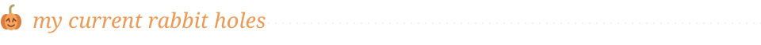

  <picture>
    <source media="(prefers-reduced-motion: reduce)" srcset="./assets/halloween-still-v2.svg" />
  
  </picture>

  

  i get a little too invested in making repetitive tasks do themselves. 
  a quick script has a funny way of becoming an entire app.

 

- **automation** — if i'm doing it again, i'm probably writing a script for it.
- **browser tools** — getting tabs, profiles, and workflows to behave themselves.
- **AI workflows** — giving models something useful to do beyond the chat box.
- **creative tools** — turning footage into clips, captions, and finished edits.
- **personal software** — oddly specific tools for my own oddly specific problems.

 

  
  
  
  

  👻 “this should only take a quick script.”

