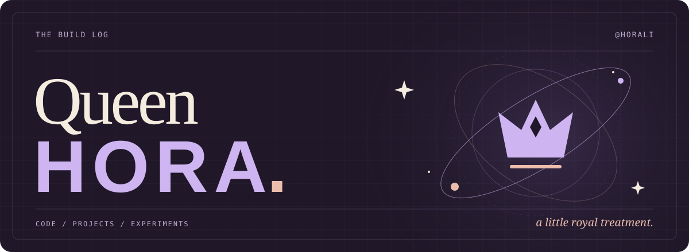

  

  <a href="https://github.com/Horali?tab=repositories">browse the projects ↗</a>
  &nbsp;&nbsp;·&nbsp;&nbsp;
  <a href="https://github.com/Horali?tab=stars">the inspiration shelf ↗</a>

 

### A few things from my corner of GitHub

<table>
  <tr>
    <td width="50%" valign="top">
      01 / BACKEND
      <h3><a href="https://github.com/Horali/RPLibrary">RPLibrary ↗</a></h3>
      
A library management REST API, built with Go, Gin, and PostgreSQL.

      
<code>Go</code> <code>Gin</code> <code>PostgreSQL</code>

    </td>
    <td width="50%" valign="top">
      02 / WEB
      <h3><a href="https://github.com/Horali/ayam-geprek-pos">ayam-geprek-pos ↗</a></h3>
      
A point-of-sale project with a very good name.

      
<code>TypeScript</code>

    </td>
  </tr>
  <tr>
    <td width="50%" valign="top">
      03 / ANDROID
      <h3><a href="https://github.com/Horali/senocam-repo">senocam-repo ↗</a></h3>
      
From the Kotlin side of the project collection.

      
<code>Kotlin</code>

    </td>
    <td width="50%" valign="top">
      04 / MORE WEB
      <h3><a href="https://github.com/Horali/laravel-vue-pos">laravel-vue-pos ↗</a></h3>
      
Another take on point of sale, this time with Laravel and Vue.

      
<code>Laravel</code> <code>Vue</code>

    </td>
  </tr>
</table>

 

  QUEEN HORA &nbsp;✦&nbsp; <a href="https://github.com/Horali?tab=repositories">there's more in the repos</a>

